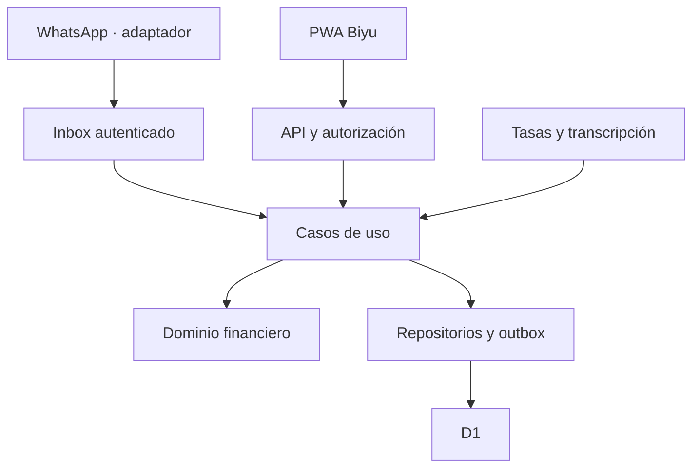

# Arquitectura de Biyu

Estado: arquitectura base propuesta para iniciar el desarrollo.
Prioridades: exactitud financiera, trazabilidad, privacidad, costo controlado y sencillez operativa.

## 1. Estilo y límites
Monolito modular con dos entradas: PWA y adaptador de WhatsApp. Un Worker aloja API y casos de uso; D1 persiste el registro financiero. Los jobs usan el mismo código de aplicación. La PWA se distribuye con Static Assets. WAHA requiere un proceso separado; no se intenta ejecutar Docker dentro de Workers.

No se necesitan microservicios, Kafka, un servidor dedicado para la API ni una base distinta por módulo. La separación es lógica y comprobable mediante dependencias.

El diagrama representa responsabilidades. Las integraciones entrantes no tienen permiso para escribir asientos por su cuenta.

## 2. Stack y responsabilidad
| Capa | Base propuesta | Responsabilidad |
| --- | --- | --- |
| Interfaz | Vue, TypeScript, Ionic, Vite | Pantallas, formularios, accesibilidad, PWA |
| Estado | Store Vue; Pinia si aporta valor | Estado de sesión, filtros y borradores, sin segunda contabilidad |
| Persistencia local | IndexedDB | Cache limitada y comandos pendientes |
| Backend | TypeScript en Workers | Autorización, validación, casos de uso |
| Router | Hono como opción ligera | HTTP; no define reglas de dinero |
| Datos | D1 con SQL parametrizado | Asientos, borradores, auditoría, inbox/outbox |
| Identidad | Cloudflare Access | Entrada privada; mapeo a usuario interno |
| WhatsApp | Puerto + adaptador WAHA | Recepción y envío; proceso externo |
| Audio | Puerto de transcripción | Texto propuesto, nunca asientos |
| Tasas | Puerto ExchangeRateProvider | Cotizaciones normalizadas con evidencia |
| Pruebas | Vitest y Playwright como base | Dominio, integración y flujos visuales |

Versiones, licencias y compatibilidad se validan en la fase 0. No fijar “latest” en producción. Mantener lockfile y versión de compatibilidad del Worker.

## 3. Capas
- **Dominio**: Money, Asset, Rate, FinancialOperation, Transfer, Fee, Journal. Funciones puras; no importa Vue, HTTP, D1 ni SDK externos.
- **Aplicación**: CreateDraft, PreviewOperation, ConfirmOperation, ReverseOperation, CorrectOperation, ReconcileBalance, LinkTransferJourney, ImportRates, ProcessInboundMessage.
- **Puertos**: UnitOfWork, LedgerRepository, DraftRepository, IdentityProvider, RateProvider, Transcriber, Messenger, Clock, IdGenerator.
- **Adaptadores**: D1, Access, WhatsApp, proveedores de tasa/audio, IndexedDB.
- **Presentación**: componentes, navegación, validación inmediata y estados; obtiene resultados del servidor.

Dependencia permitida: presentación/adaptadores → aplicación → dominio. El dominio no conoce sus adaptadores. Contratos serializables se comparten, pero los secretos y repositorios del servidor no se empaquetan en la PWA.

## 4. Módulos funcionales
| Módulo | Posee | No puede hacer |
| --- | --- | --- |
| Identity | Usuarios, espacios, canales vinculados | Confiar en owner_id enviado por cliente |
| Accounts | Cuentas, bolsillos, archivo | Borrar historial al archivar |
| Ledger | Operaciones, asientos y reversos | Consumir IA para decidir importes |
| Transfers | Tramos, fees, recorridos | Contabilizar aparte del Ledger |
| Catalogs | Categorías y activos | Cambiar escala de activo con historial |
| Rates | Cotizaciones y snapshots | Reescribir importes originales |
| Planning | Presupuestos, metas, recurrentes | Cambiar saldos por una proyección |
| Conversation | Inbox, borradores y confirmaciones | Saltarse autorización o reglas financieras |
| Reporting | Consultas y proyecciones derivadas | Ser la fuente primaria de saldos |
| Operations | Outbox, auditoría, exportación | Exponer información sensible en logs |

## 5. Estructura objetivo
Carpetas sugeridas; deben crearse en implementación, no están incluidas como código funcional.

| Ruta | Contenido |
| --- | --- |
| apps/web/src/features | Módulos de pantalla |
| apps/web/src/components | Sistema visual reutilizable |
| apps/web/src/offline | IndexedDB, outbox local, reconciliación |
| apps/api/src/http | Rutas y middleware |
| apps/api/src/application | Casos de uso |
| apps/api/src/adapters | Repositorios y proveedores |
| apps/api/src/jobs | Procesadores programados |
| packages/domain | Dinero y reglas puras |
| packages/contracts | Esquemas API y tipos serializables |
| packages/test-fixtures | Datos ficticios y escenarios |
| migrations | SQL incremental y semillas del sistema |
| tests/e2e | Flujos de extremo a extremo |
| docs, adr | Documentación y decisiones |

No crear un paquete compartido por cada archivo. Empezar con domain y contracts.

## 6. Contabilización: una sola frontera atómica
1. Autenticar y obtener workspace_id desde la identidad.
2. Validar entrada, versión de borrador y confirmación.
3. Recalcular en servidor con Money/Rate; nunca aceptar un saldo calculado por el navegador.
4. Construir asientos balanceados por activo y proyecciones necesarias.
5. Ejecutar una sola unidad de trabajo con D1 Worker binding batch: reclamar idempotencia, insertar operación/asientos/fees, validar publicación, cambiar versión del borrador, auditar y agregar outbox.
6. Devolver operation_id y estado confirmado.
7. Procesar notificaciones desde outbox fuera de la transacción.

Los checks que dependen de estado cambiante se verifican dentro de la escritura, mediante constraints, triggers o actualizaciones condicionales con una guardia que falle si no se modifica la fila esperada. Un UPDATE con cero filas no es un error SQL y no debe dejar otros INSERT confirmados. Lecturas previas sirven para previsualizar, no para garantizar concurrencia.

No usar varias llamadas independientes como una “transacción”. DATABASE define la guardia de publicación. Probar rollback real en D1 local/remoto de pruebas antes de dar el adaptador por terminado.

## 7. Consistencia
- El ledger contabilizado es la fuente de verdad.
- Los asientos no se editan. Correcciones generan reverso y reemplazo atómicos.
- El saldo visible confirmado se deriva de asientos publicados, incluyendo reversos.
- Una proyección cacheada guarda su cursor y puede reconstruirse.
- Si se habilitan réplicas D1, usar sesiones/bookmarks para lectura después de escritura; inicialmente operar sobre primaria.
- Recorridos agrupan tramos, no crean una segunda transacción ni un segundo costo.
- Inbox y outbox ofrecen entrega al menos una vez; la idempotencia evita efectos financieros repetidos.
- La respuesta HTTP perdida después del commit se resuelve repitiendo el mismo comando y clave.

## 8. WhatsApp y confianza
El webhook solo autentica el adaptador, almacena inbox y responde tras persistir. Un job normaliza el mensaje, resuelve el vínculo de usuario y produce un borrador. Una confirmación está ligada a usuario, borrador, versión y expiración. Cambiar importe, cuenta o tasa invalida la confirmación previa.

La IA es un adaptador reemplazable para extraer intención. Debe devolver un esquema cerrado; cualquier cuenta desconocida, ambigüedad o dato faltante requiere aclaración. Parser determinista y registro manual siguen funcionando cuando no hay cuota de IA.

## 9. Offline
Modelo online-authoritative con borradores offline. No se promete contabilidad final offline, sincronización en segundo plano permanente ni disponibilidad de WhatsApp sin servidor. La app guarda intenciones locales, muestra pendientes por separado y revalida al reconectar. Detalle en OFFLINE_SYNC.

## 10. Jobs sin infraestructura excesiva
Inbox/outbox en D1 y un procesador programado son la base inicial. Reclamo por lease con token y vencimiento; intentos y backoff; cola de errores revisable. Workers Queues solo si una medición justifica su costo y límites. No confiar exclusivamente en tareas posteriores a la respuesta HTTP para trabajo durable.

## 11. Costo cero y degradación
PWA + API manual deben poder funcionar con integraciones desactivadas. Definir cuotas internas menores a límites externos, deshabilitar funciones opcionales al agotarse y permitir tasas/manuales o texto. No garantizar hosting gratuito permanente de WAHA ni de audio. No habilitar planes pagados para resolver una limitación sin decisión explícita.

## 12. Despliegue y evolución
Entornos local, prueba y producción separados; migraciones primero compatibles hacia adelante; activar funciones con flags. Cambios destructivos requieren exportación verificada y ruta de recuperación. Infraestructura concreta y dominio se definen en fase 0; no están contratados.

Considerar PostgreSQL solo cuando D1 limite de forma medida integridad, consultas, volumen o colaboración. Considerar una app nativa solo ante necesidades comprobadas de dispositivo. El dominio y los contratos deben permitir ambos cambios sin rehacer las reglas financieras.

## 13. Objetivos de calidad propuestos
API manual: p95 menor a 1 segundo excluyendo red móvil y proveedores externos, a medir; carga inicial usable menor a 3 segundos en perfil móvil registrado; listas paginadas y agregaciones indexadas. Ningún objetivo de latencia justifica omitir validación ni mostrar saldos no confirmados como definitivos.

Referencias de plataforma: SOURCES. Estas metas y el diseño modular son decisiones del proyecto, no garantías de proveedores.

